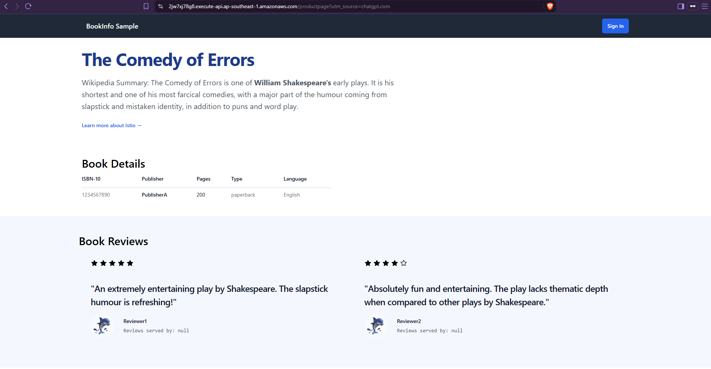
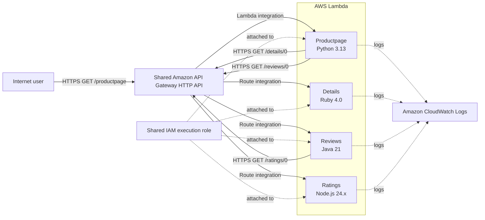

# AWS Serverless Bookinfo

An adaptation of the [Istio Bookinfo sample](https://istio.io/latest/docs/examples/bookinfo/) that runs its four application services as independent AWS Lambda functions. The services exchange synchronous HTTPS requests through one Amazon API Gateway HTTP API.

[View Live Bookinfo Application](https://2jw7xj78g8.execute-api.ap-southeast-1.amazonaws.com/productpage)

Health check: [`GET /health`](https://2jw7xj78g8.execute-api.ap-southeast-1.amazonaws.com/health) returns `Product page is healthy` with HTTP 200.

## Application Preview



The screenshot shows the Bookinfo page rendered by Productpage Lambda with book details and reviews returned by the other services.

## Architecture



The four functions are independent Lambda functions, but they use a **single shared API Gateway HTTP API**. Productpage calls Details and Reviews over HTTPS; Reviews calls Ratings the same way. There is no direct Lambda-to-Lambda AWS SDK invocation.

## Deployed AWS configuration

The deployment details below describe the live deployment as provided for this project. Deployment was performed manually in the AWS Management Console; Terraform and CI/CD are not used.

| Resource | Deployed configuration |
| --- | --- |
| AWS Region | `ap-southeast-1` (Singapore) |
| API Gateway | `bookinfo-http-api`, HTTP API, `$default` stage, automatic deployment enabled |
| API payload | Lambda proxy integration, payload format 2.0 |
| IAM role | Shared `bookinfo-lambda-execution-role` |
| IAM logging policy | `AWSLambdaBasicExecutionRole` |
| Logging | Lambda logs in Amazon CloudWatch Logs |

The shared role is an existing design choice, not a per-function least-privilege setup. Separate roles with narrower permissions are a future improvement.

## Microservices

| Service | Lambda function | Runtime | Handler | Responsibility |
| --- | --- | --- | --- | --- |
| Productpage | `bookinfo-productpage` | Python 3.13 | `lambda_handler.lambda_handler` | Flask application that assembles service responses and renders the web page. |
| Details | `bookinfo-details` | Ruby 4.0 | `details.lambda_handler` | Returns static book information. |
| Reviews | `bookinfo-reviews` | Java 21 | `application.ReviewsHandler` | Returns the two Bookinfo reviews and retrieves their ratings. |
| Ratings | `bookinfo-ratings` | Node.js 24.x | `index.handler` | Returns the default in-memory ratings. |

These runtime versions reflect the deployed configuration provided for this review. The existing [Details service README](details/README.md) lists Ruby 3.4 and the [Ratings service README](ratings/README.md) lists Node.js 22.x; both conflict with the deployed runtime versions above (Ruby 4.0 and Node.js 24.x). Reconcile those service-level documents before publishing the repository.

### Request flow

1. A user opens `/productpage` over HTTPS.
2. API Gateway routes the request to Productpage Lambda.
3. Productpage requests book details from the Details route through API Gateway.
4. Productpage requests reviews from the Reviews route through API Gateway.
5. Reviews requests ratings from the Ratings route through API Gateway.
6. Ratings returns the default values, Reviews combines them with review content, and Productpage renders the HTML page.

These are synchronous HTTP requests. The endpoint and handler implementations are in [Productpage](productpage/productpage.py), [Details](details/details.rb), [Reviews](reviews/reviews-application/src/main/java/application/ReviewsHandler.java), and [Ratings](ratings/index.js).

## API routes

The configured API Gateway routes reported for the deployment are:

| Method | API Gateway route | Integration |
| --- | --- | --- |
| `GET` | `/productpage` | Productpage Lambda |
| `GET` | `/details/{productId}` | Details Lambda |
| `GET` | `/reviews/{productId}` | Reviews Lambda |
| `GET` | `/ratings/{productId}` | Ratings Lambda |
| `GET` | `/static/{proxy+}` | Productpage Lambda, for static assets |
| `GET` | `/health` | Productpage Lambda (`bookinfo-productpage`) |

The Flask application also defines `/`, `/index.html`, `/login`, `/logout`, `/api/v1/products`, `/api/v1/products/{product_id}`, `/api/v1/products/{product_id}/reviews`, `/api/v1/products/{product_id}/ratings`, and `/metrics`. These are application routes; their presence in Flask does not by itself establish that each is a separately configured API Gateway route.

The static route is needed to serve images and styles used by the Productpage. API Gateway routing must forward the paths to the intended integration; an application route alone does not configure API Gateway.

## Service configuration

Configure backend base URLs as HTTPS API Gateway base URLs, not as direct Lambda invocation targets.

| Environment variable | Used by | Purpose |
| --- | --- | --- |
| `DETAILS_BASE_URL` | Productpage | Base URL used for `GET /details/{productId}`. |
| `REVIEWS_BASE_URL` | Productpage | Base URL used for `GET /reviews/{productId}`. |
| `RATINGS_BASE_URL` | Productpage and Reviews | Base URL used for `GET /ratings/{productId}`. |
| `FLASK_SECRET_KEY` | Productpage | Signs Flask session cookies. Set a long, random value and never publish it. |

Example URL shape (not a credential):

```text
https://<api-id>.execute-api.<region>.amazonaws.com
```

Productpage requires `FLASK_SECRET_KEY` and the backend base URLs in Lambda. Reviews requires `RATINGS_BASE_URL`. The current Details and Ratings handlers do not require environment variables.

## Build and package

The following commands match the build/package instructions in the service directories. They create deployment ZIPs only; they do not upload or deploy them.

| Service | Required tools | Command from the workspace root | ZIP output |
| --- | --- | --- | --- |
| Productpage | Python/pip, `zip`, network access to PyPI | `cd productpage && ./build_lambda.sh` | `productpage/build/productpage-lambda.zip` |
| Details | `zip` | `cd details && zip ../details-lambda.zip details.rb` | `details-lambda.zip` |
| Reviews | JDK 17+, Gradle 8.13+ | `cd reviews && gradle :reviews-application:clean :reviews-application:test :reviews-application:lambdaZip` | `reviews/reviews-application/build/distributions/reviews-lambda.zip` |
| Ratings | `zip` | `cd ratings && zip ../ratings-lambda.zip index.js package.json` | `ratings-lambda.zip` |

Productpage's build script packages the Flask handler, application, dependencies, templates, and static files for Python 3.13 on Linux x86_64. Reviews' Gradle task places the application JAR and runtime dependencies under `lib/` in the Java Lambda ZIP. Details and Ratings use small ZIPs containing their handlers and, for Ratings, its package manifest.

## Manual deployment workflow

The deployment is managed manually through the AWS console:

1. Build each service's Lambda ZIP.
2. Create the shared IAM execution role and attach the CloudWatch logging policy.
3. Create the four Lambda functions with the deployed runtimes and handlers listed above.
4. Upload each service's ZIP and configure its environment variables, timeout, and memory settings.
5. Create or configure the API Gateway HTTP API, its routes, and Lambda proxy integrations using payload format 2.0.
6. Use the `$default` stage with automatic deployment enabled.
7. Test each endpoint, then test the service-to-service requests and render the Productpage in a browser.

This is a manual deployment process, not an automated pipeline.

## Testing and validation

### Unit tests

The following successful local unit-test counts were reported previously; they were not rerun as part of this README review.

| Service | Result | Local test command |
| --- | --- | --- |
| Ratings | 6 tests passed | `cd ratings && npm test` |
| Details | 8 tests passed | `cd details && ruby -Itest test/details_test.rb` |
| Reviews | 10 tests passed | `cd reviews && gradle :reviews-application:test` |
| Productpage | 14 tests passed | `cd productpage && python -m unittest discover tests/unit` |

Productpage unit tests were run locally with Python 3.12; the deployed Lambda runtime is Python 3.13. Local unit tests mock or construct API Gateway events and do not invoke deployed AWS resources. Install Productpage's existing `requirements.txt` and `test-requirements.txt` before running its test command; see the [Productpage service README](productpage/README.md).

### Lambda function and API Gateway integration tests

The HTTP status checks below are reported API Gateway endpoint tests against the deployed application; no separate Lambda-console test results were provided.

- `GET /ratings/0`, `GET /details/0`, `GET /reviews/0`, `GET /productpage`, and the static image endpoint returned HTTP 200.
- `GET /health` returned HTTP 200 with `Product page is healthy`.
- Reviews returned ratings in its response.

### Browser verification

The Productpage was reported to render successfully in a browser; the screenshot is included above. This browser check is separate from unit tests and API Gateway endpoint checks.

Load testing, penetration testing, and high-availability testing have not been performed.

## Challenges and troubleshooting

The following deployment issues and resolutions were reported during the project:

| Symptom | Investigation and resolution |
| --- | --- |
| Reviews failed with `ClassNotFoundException: application.ReviewsHandler`. | The application JAR was at the ZIP root instead of `lib/`. The Gradle packaging task was corrected to place the application and dependency JARs under `lib/`. |
| Productpage failed with `Runtime.ImportModuleError`. | The Lambda handler setting was corrected to `lambda_handler.lambda_handler`. |
| Productpage initially failed to retrieve Reviews; CloudWatch showed `Read timed out. (read timeout=3.0)`. | Backend health was checked and the request succeeded after correcting the Python runtime configuration. The timeout is not attributed to an unverified cause. |
| The page initially loaded without its expected styling. | Investigation found that API Gateway did not have a static asset route. `GET /static/{proxy+}` was added and attached to Productpage Lambda. |

The troubleshooting process used Lambda/CloudWatch error output, checked handler and packaging configuration, verified backend health, and retested the HTTP endpoints and browser rendering.

## Security and limitations

- The application uses HTTPS for service-to-service requests through API Gateway.
- All four Lambda functions currently share `bookinfo-lambda-execution-role`. Per-function least-privilege roles are not implemented.
- The API is reachable through a public API Gateway execute-api URL. Authentication and authorization are not configured as part of this project; do not treat the demo as a protected production service.
- `FLASK_SECRET_KEY` must be configured as a secret and must not be committed or shown in documentation.
- The inherited Flask login is a demonstration feature. It stores a submitted username and is not production authentication.
- The Ratings response is in memory and is not persistent. Details returns static information.
- The project is a portfolio demonstration, not a production-ready system.

## Future improvements

Planned improvements—not currently implemented—include:

- Route 53 custom domain and an ACM TLS certificate.
- API Gateway authentication and authorization.
- Separate least-privilege IAM roles for each Lambda function.
- Improved observability, CloudWatch alarms, and distributed tracing.
- CI/CD deployment automation and infrastructure as code.
- Performance testing, cold-start optimization, and more robust backend timeout/retry policies.

## Project structure

```text
.
├── README.md
├── docs/
│   └── images/
│       └── bookinfo-ui.png
├── productpage/
│   ├── lambda_handler.py
│   ├── productpage.py
│   ├── build_lambda.sh
│   ├── lambda-requirements.txt
│   ├── static/
│   ├── templates/
│   └── tests/
│       └── unit/
├── details/
│   ├── details.rb
│   └── test/
│       └── details_test.rb
├── reviews/
│   └── reviews-application/
│       ├── build.gradle
│       └── src/
│           ├── main/java/application/ReviewsHandler.java
│           └── test/java/application/ReviewsHandlerTest.java
└── ratings/
    ├── index.js
    ├── package.json
    └── tests/
        └── ratings.test.js
```

Legacy Dockerfiles and container-era code remain in the workspace but are not required by the listed Lambda ZIP builds. Generated ZIPs and build output are deployment artifacts, not source files.

## References and attribution

This project adapts the original Istio Bookinfo sample; it does not claim authorship of that application. Upstream license and copyright notices are retained in the source files.

- [Istio Bookinfo documentation](https://istio.io/latest/docs/examples/bookinfo/)
- [Original Istio Bookinfo source](https://github.com/istio/istio/tree/master/samples/bookinfo/src)
- [AWS Lambda documentation](https://docs.aws.amazon.com/lambda/latest/dg/welcome.html)
- [Amazon API Gateway HTTP APIs](https://docs.aws.amazon.com/apigateway/latest/developerguide/http-api.html)
- [AWS Lambda execution role](https://docs.aws.amazon.com/lambda/latest/dg/lambda-intro-execution-role.html)
- [Viewing Lambda logs in CloudWatch](https://docs.aws.amazon.com/lambda/latest/dg/monitoring-cloudwatchlogs.html)
